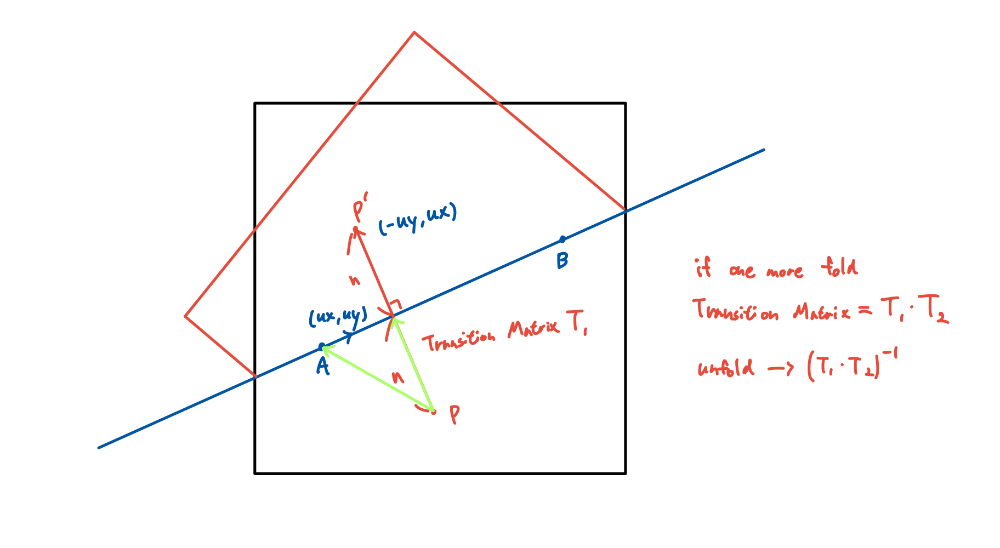

# 눈결정 만들기

- 컴퓨터 그래픽스 Project 2
- 202455451 장호빈

## 1. 고른 이유

Rabbit Ear 오픈소스와, iCurve 오픈소스를 만져보다가 유치원, 초등학교 때 했었던 눈결정 만들기가 생각났다. 겨울이기도 하고, 웹사이트로 구현했을 때 재미있을 것 같아 선택하였다.

구조 상 종이를 접고 오린 뒤 펼치면 한 번의 입력이 여러 위치의 무늬로 나타난다. 이 과정에서 2D 반사 변환, 면 분할, 베지어 곡선, 도형의 교집합을 함께 보여줄 수 있다고 생각했다. 사용자가 접는 위치, 각도, 방향을 직접 정하고 펼친 결과를 비교하도록 하였다.

Rabbit Ear는 종이의 접기와 면별 변환을 계산하고, iCurve는 곡선이 포함된 닫힌 영역의 교집합과 차집합을 계산한다. 두 라이브러리를 연결하여 접힌 면과 원래 종이 사이의 대응을 직접 구현할 수 있다.

사용한 오픈소스의 역할은 다음과 같다.

- Rabbit Ear 0.9.41: FOLD 그래프, `flatFold`, 면별 행렬과 겹 순서 계산
- iCurve: 직선과 베지어 경로의 Boolean 연산
- iShape-js WASM 3.1.0: Rust 기하 기능을 JavaScript에서 호출하는 연결부

## 2. 원리 설명

### 2.1. Rabbit Ear의 FOLD 그래프와 면 변환

Rabbit Ear는 종이를 정점, 변, 면으로 이루어진 FOLD 그래프로 저장한다. `flatFold`는 접힌 화면의 직선을 각 면의 역행렬로 원래 좌표에 옮겨 면을 분할한다. 이후 반사된 면의 변환 행렬과 겹 순서를 갱신한다. 면마다 변환이 다르므로 화면의 같은 위치에 여러 겹이 놓일 수 있다.

접는 직선은 기준점 A와 단위 방향 벡터 d로 표현한다.

임의 각도의 반사는 선에 수직인 단위 벡터 n을 이용해 설명할 수 있다. 접힌 화면의 점 P에서 선까지의 수직 거리를 구하고, 그 거리의 두 배만큼 반대쪽으로 옮긴 점이 반사된 점이다. Rabbit Ear가 이 반사를 면별 변환 행렬로 계산한다.

```text
n = (-dy, dx)
P' = P - 2*n*dot(n, P-A)
```

`faces_matrix2`는 원래 좌표를 접힌 위치로 옮기는 여섯 값이다.

```text
T = [a, b, c, d, tx, ty]
x' = a*x + c*y + tx
y' = b*x + d*y + ty
```

정사각형의 좌표 범위는 0~1이고, SVG와 같이 y가 아래로 증가한다. 예를 들어 x=0.5에서 왼쪽을 넘기면 반사된 면의 변환은 다음과 같다.

```text
T = [-1, 0, 0, 1, 1, 0]
x' = 1-x, y' = y
(0.20, 0.30) -> (0.80, 0.30)
```

오른쪽 면의 점 (0.80, 0.30)은 그대로 있으므로 같은 화면 위치에서 두 겹이 된다. 아래쪽을 y=0.5에서 접는 반사는 y'=1-y이다. 가로와 세로 중앙 접기를 함께 적용하면 네 면이 포개진다. 중앙을 벗어난 x=0.35에서 왼쪽을 넘기면 x'=0.70-x가 되어 (0.20, 0.30)이 (0.50, 0.30)으로 이동한다. 접는 선이 바뀌면 반사 기준도 함께 바뀌는 예다.



접기 원리 설명 그림. 본문의 열벡터 표기에서 첫 접기가 T1, 다음 접기가 T2이면 합성은 T2*T1이며, 펼치기는 그 역행렬로 계산한다.

### 2.2. iCurve의 경로 연산과 경계 처리

iCurve는 닫힌 직선·베지어 경로의 교집합과 차집합을 계산한다.

**경계를 처리하는 과정**

- 입력과 좌표 정리: 경로가 닫혀 있고 좌표가 유효한지 확인한다. 두 입력을 같은 정수 좌표 격자로 옮겨, 같은 위치가 서로 다른 좌표로 처리되지 않도록 한다.
- 경계 분할과 연결 관계 구성: 곡선을 작은 구간으로 나누고 원래 곡선의 번호와 매개변수 범위를 기록한다. 굽은 정도에 따라 짧은 선분으로 근사하고 교차점 주변을 처리해, 경계가 어디에서 만나고 이어지는지 나타내는 평면 그래프를 구성한다.
- 남길 경계 선택: 내부 iOverlay 엔진이 각 영역이 두 입력 도형의 안쪽인지 바깥쪽인지 분류한다. 교집합은 두 영역 모두의 안쪽을, 차집합은 첫 번째 도형 안이면서 두 번째 도형 밖인 부분을 둘러싸는 경계를 선택한다.
- 결과 윤곽 복원: 선택한 경계를 따라 닫힌 윤곽을 만든다. 같은 원래 곡선에서 나온 인접 구간을 합치고 기록한 곡선 정보로 직선·베지어 구간을 복원한 뒤, 원래 실수 좌표로 돌려준다. 따라서 결과에도 곡선 경계가 남는다.

`FillRule.EvenOdd`는 채움 규칙의 하나이다. 경계를 가로지를 때마다 안과 밖이 번갈아 바뀌는 규칙이다. 예를 들어 종이 가운데 닫힌 영역을 잘라내면 종이의 바깥 테두리와 잘라낸 영역의 안쪽 테두리가 함께 결과에 포함되고, 안쪽 테두리의 내부는 구멍으로 표시된다.

이 내부 처리 흐름은 [iCurve 공식 설명](https://github.com/iShape-Rust/iCurve#how-it-works)을 참고했다. 정수 격자와 근사를 이용하므로 아주 작은 틈이나 조각은 계산 정밀도의 영향을 받을 수 있다.

## 3. 내가 바꾼 것

- 자유로운 접기 선 입력: 화면에서 두 점을 찍어 접는 선의 위치와 각도를 자유롭게 정하고, 세 번째 클릭으로 넘길 방향을 선택하도록 했다. `app.js`의 `selectFold`와 `paper.js`의 `makeLine`, `signedDistance`, `foldPaper`를 연결해 Rabbit Ear가 제공하는 임의 직선 접기 기능을 사용자 조작으로 사용할 수 있게 했다.
- 연속 접기와 면 추적: 이전 접기 결과에 다음 선을 계속 적용하고, 분할된 면의 `parent`와 역행렬을 저장해 펼칠 때 원래 위치를 찾도록 했다.
- 직선·베지어 오리기: `app.js`와 `cut.js`에서 경로 닫기, 조절점 드래그, 미리보기, 면별 연산을 연결했다.
- 영역 남기기: 교집합과 차집합의 결과를 `remaining`과 `removed`에 서로 바꾸어 저장하도록 했다.
- 단계별 펼치기와 되돌리기: `ancestorAt`으로 조상 면을 찾고 `renderMaterial`에서 해당 행렬을 적용했다. 상태 이력으로 이전 조작을 복구하도록 했다.
- 이름 보관함과 눈 내리는 밤: `snow.js`에서 실제 SVG 윤곽과 이름을 브라우저 저장소에 보관하고, 저장한 모양이 눈처럼 내리도록 했다.

### 3.1. 자유로운 접기 선 입력과 방향 선택

접기에서는 화면의 서로 다른 두 점 A와 B를 선택한다. A를 직선의 기준점으로, B-A를 정규화한 벡터 d를 방향으로 사용한다. 두 점 사이에 한정된 선분이 아니라 그 방향으로 이어지는 직선을 접기 기준으로 사용한다.

세 번째 클릭 S로 넘길 쪽을 선택한다. 선 벡터와 선택점 사이의 외적 부호 s를 계산하고, 선택점이 음수 쪽이면 선 벡터를 뒤집는다. 사용한 `flatFold` 구현은 양의 외적 쪽을 넘기므로 선택한 쪽에 겹쳐 있는 면을 함께 접을 수 있다.

```text
d = (B-A) / |B-A|
L(t) = A + t*d
s = dx*(Sy-Ay) - dy*(Sx-Ax)
```

오리기 전에는 같은 방식으로 다음 선을 입력해 접기를 이어갈 수 있다. 같은 점을 반복하거나 종이를 가르지 않는 선을 입력하면 접기를 확정하지 않고 안내한다.

### 3.2. 연속 접기와 면 추적

연속 접기는 이전 그래프를 복제해 다음 `flatFold`에 전달한다. 따라서 이전 단계의 분할과 변환을 이어 사용하면서 되돌리기도 보존한다. 반환값 `change.faces.map`을 반대로 읽어 새 면마다 이전 면의 번호인 `parent`를 기록한다. 각 면에는 원래 다각형, 현재 다각형, 행렬, 역행렬, 겹 순서를 저장한다.

### 3.3. 면별 오리기와 영역 남기기

웹에서는 `FillRule.EvenOdd`를 사용한다.

연산은 각 면에 따로 적용한다. 접힌 좌표에서 i번째 면에 남은 종이를 M_i, 사용자가 그린 영역을 C라고 하면 다음과 같다.

```text
잘라내기 후 남는 종이 = M_i - C
영역 남기기 후 남는 종이 = M_i intersect C
원래 좌표에 보관할 조각 = inverse(T_i)(연산 결과)
```

같은 경로라도 어떤 면에는 닿고 다른 면에는 닿지 않을 수 있다. 면의 경계에 따라 잘린 윤곽도 달라진다. 실제 검증에서는 x=0.37 접기 후 사선으로 접었을 때 네 면 중 두 면만 잘렸다. 두 면의 잘린 경계는 각각 3구간과 2구간으로 달랐으며, 펼친 결과에서는 내부 구멍과 오른쪽 가장자리 파임으로 나타났다.

여러 번 오릴 때는 이전 결과의 `remaining`을 다음 재료로 사용한다. 이미 잘라낸 구멍이 다시 채워지는 것을 방지하기 위해서다. 경로가 종이 밖까지 넘어가면 실제 재료와 겹치는 부분에만 절단이 반영된다.

### 3.4. 베지어 곡선의 변환

3차 베지어 곡선은 시작점 P0, 조절점 P1과 P2, 끝점 P3의 가중합이다.

```text
B(t) = (1-t)^3*P0 + 3*(1-t)^2*t*P1
     + 3*(1-t)*t^2*P2 + t^3*P3
```

아핀 변환은 이 가중합과 교환된다. 따라서 끝점과 두 조절점에 같은 행렬을 적용하면 곡선 전체를 올바르게 반사할 수 있다. `transformPaths`가 각 점에 동일한 변환을 적용한다.

### 3.5. 접기 이력을 이용한 펼치기

잘린 조각을 각 면의 역행렬로 원래 종이 좌표에 저장한다. 펼칠 때는 최종 면의 `parent`를 따라 표시할 단계의 조상 면을 찾고, 그 조상 면의 행렬을 조각에 적용한다. 따라서 중간 단계에서도 구멍이 종이와 함께 이동한다.

```text
접힌 점 q
-> 원래 점 p = inverse(T_final)(q)
-> 표시 단계의 점 = T_step(p)
```

가로와 세로로 중앙 접기를 한 상태에서 q=(0.80, 0.30)에 구멍을 내면, 네 면의 역변환으로 다음 원래 위치를 얻는다.

```text
(0.20, 0.30), (0.80, 0.30)
(0.20, 0.70), (0.80, 0.70)
```

화면에서는 같은 조상 면의 경로를 묶고 SVG의 `evenodd` 채움 규칙으로 구멍을 표현한다.

## 4. 막혔던 것과 해결

### 4.1. 비대칭 접기에서 겹마다 다른 절단

화면의 한 모양을 복제하면 일부 겹만 잘리는 상황을 표현할 수 없다. 각 면과 오리기 영역을 따로 연산하고, 결과를 면별 역행렬로 원래 좌표에 저장해 해결했다.

### 4.2. 다음 접기에서 바뀌는 면 번호

면을 분할한 뒤에는 이전 면 번호를 그대로 사용할 수 없다. `flatFold`가 반환하는 면 변경표에서 각 새 면의 `parent`를 구성해 이전 단계의 면을 추적했다.

### 4.3. 곡선과 구멍의 중간 펼치기

끝점만 변환하면 베지어 곡선의 모양이 달라진다. 시작점, 끝점, 조절점을 함께 변환하고, 표시 단계의 조상 면별 경로로 묶어 해결했다.

## 5. AI 사용 내역

OpenAI Codex를 사용했다. 요청한 작업과 AI가 맡은 작업은 다음과 같다.

- 원본 코드 분석과 라이브러리 연결: `flatFold` 호출부, 면 출처 추적, 역변환과 조상 변환, SVG 입출력 코드를 작성하도록 요청했다.
- 기능과 디자인 개선: 영역 남기기, 보관함 이름, 눈 내리기, 겨울 색상과 버튼·작업대 조정을 요청했다.
